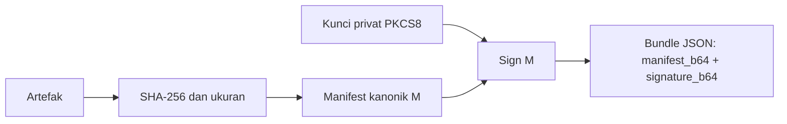
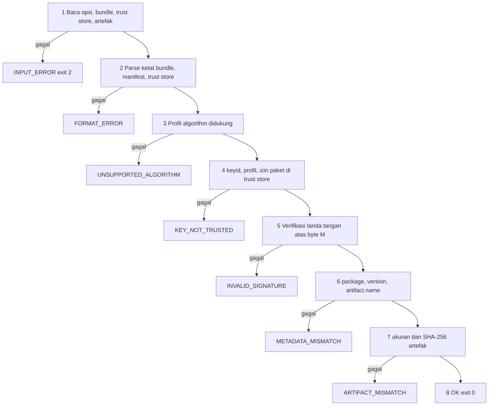

# Laporan Tugas Besar 3 IF4020 Kriptografi
## Penandatanganan dan Verifikasi Software Release (NoraSign)

Semester I Tahun 2026/2027

Disusun oleh:

- Brian Hadian Albar (13523048)
- Andrew Isra Saputra DB (13523110)

Program Studi Teknik Informatika, Sekolah Teknik Elektro dan Informatika, Institut Teknologi Bandung, 2026

Dokumen ini adalah salinan isi laporan untuk repositori. Berkas laporan resmi (PDF) mengikuti format `13523048_13523110_Tugas3_IF4020.pdf`.

## Daftar Isi

- BAB I Pendahuluan
- BAB II Dasar Teori
- BAB III Perancangan Sistem
- BAB IV Implementasi dan Simulasi
- BAB V Analisis Keamanan dan Performa
- BAB VI Kesimpulan dan Saran
- Daftar Pustaka
- Lampiran

## BAB I - PENDAHULUAN

### 1.1 Latar Belakang

Distribusi perangkat lunak modern melewati banyak perantara: build server, mirror, registry, dan relay pembaruan. Setiap perantara membuka peluang bagi pihak lain untuk mengganti atau memodifikasi berkas rilis sebelum sampai ke pengguna. Kisah Nora dan ROBO pada lore tugas menggambarkan kondisi ini: pembaruan yang diterima dari relay pemeliharaan harus dapat dibuktikan berasal dari penerbit yang sah sebelum dipasang.

Checksum biasa tidak cukup untuk masalah tersebut. Penyerang yang mampu mengganti berkas rilis biasanya juga mampu mengganti berkas checksum di sebelahnya. Yang dibutuhkan adalah ikatan kriptografis antara isi rilis dan identitas penerbit, yaitu tanda tangan digital yang hanya dapat dibuat oleh pemegang kunci privat dan dapat diperiksa oleh siapa pun yang memiliki kunci publik tepercaya.

Tugas ini membangun NoraSign, kakas CLI untuk menandatangani dan memverifikasi rilis perangkat lunak dengan tiga algoritma tanda tangan: RSASSA-PSS, ECDSA P-256, dan Ed25519. NoraSign didistribusikan sebagai image container sehingga dapat dipakai langsung sebagai gerbang verifikasi pada pipeline CI/CD.

### 1.2 Tanda Tangan Digital dan Sigstore Cosign

Tanda tangan digital memberikan tiga jaminan: integritas (data tidak berubah setelah ditandatangani), autentikasi asal (hanya pemilik kunci privat yang dapat membuat tanda tangan sah), dan nirsangkal. Tanda tangan tidak menyatakan bahwa perangkat lunak bebas malware. Tanda tangan hanya menyatakan bahwa byte yang diterima sama dengan byte yang disetujui penerbit.

Sigstore Cosign adalah kakas industri untuk menandatangani image container dan blob. Pada mode blob signing, Cosign menghitung digest berkas, menandatanganinya, lalu menyimpan tanda tangan, sertifikat, dan bukti transparency log (Rekor) dalam satu bundle. Identitas penerbit dapat berasal dari kunci statis atau dari sertifikat berumur pendek yang diterbitkan Fulcio berdasarkan identitas OIDC.

NoraSign mengadaptasi alur tersebut dengan beberapa perbedaan. Yang ditandatangani bukan digest berkas secara langsung, melainkan release manifest kanonik yang memuat nama paket, versi, algoritma, keyid, serta nama, ukuran, dan SHA-256 artefak. Kepercayaan ditentukan oleh trust store lokal yang dikelola pengguna, tanpa layanan sertifikat atau transparency log, sehingga verifikasi dapat berjalan sepenuhnya offline dengan --network none.

**Tabel 1.1 Perbandingan Sigstore Cosign dan NoraSign**

| Aspek | Sigstore Cosign (blob) | NoraSign |
| --- | --- | --- |
| Pesan yang ditandatangani | Digest berkas atau payload in-toto | Byte manifest kanonik berisi metadata dan SHA-256 artefak |
| Identitas penerbit | Kunci statis atau sertifikat Fulcio (OIDC) | Kunci publik di trust store lokal |
| Bukti waktu dan transparansi | Rekor transparency log | Tidak ada (di luar cakupan) |
| Format keluaran | Bundle Sigstore | minisign-bundle/v1 (JSON, Base64) |
| Ketergantungan jaringan | Dibutuhkan untuk mode keyless | Tidak ada, berjalan dengan --network none |
| Algoritma | ECDSA P-256 sebagai default | RSA-PSS 3072, ECDSA P-256, Ed25519 |


### 1.3 Gagasan dan Pendekatan Rancangan

Rancangan NoraSign berpegang pada empat gagasan berikut.
- Pesan yang ditandatangani adalah byte manifest kanonik. Metadata rilis ikut terlindungi tanda tangan, dan verifier memeriksa tanda tangan atas byte yang tersimpan di bundle tanpa memformat ulang.
- Parsing ketat di semua masukan. Field duplikat, field tambahan, nilai null, tipe yang salah, BOM, dan Base64 tidak kanonik ditolak sebelum operasi kriptografi dijalankan.
- Verifikasi berurutan dan berhenti pada kegagalan pertama, dengan status dan exit code yang dapat dibaca mesin sehingga pipeline dapat menghentikan deployment secara deterministik.
- Kepercayaan hanya berasal dari trust store yang disiapkan sebelumnya. Bundle tidak pernah dapat menambahkan kunci, profil, atau izin paket.

## BAB II - DASAR TEORI

### 2.1 Fungsi Hash SHA-256

SHA-256 adalah fungsi hash kriptografis keluarga SHA-2 yang memetakan masukan sembarang panjang menjadi digest 256 bit. Sifat yang dibutuhkan pada tugas ini adalah ketahanan preimage kedua dan ketahanan tabrakan: penyerang tidak dapat membuat berkas lain dengan digest yang sama. NoraSign memakai SHA-256 untuk tiga hal: digest artefak di manifest, fingerprint kunci publik (keyid = hex_lower(SHA-256(DER_SPKI))), dan sebagai fungsi hash di dalam RSA-PSS dan ECDSA.

### 2.2 Kunci Publik dan Kunci Privat

Kriptografi kunci publik memakai pasangan kunci. Kunci privat disimpan rahasia oleh penerbit dan dipakai untuk menandatangani. Kunci publik dibagikan dan dipakai untuk memverifikasi. Keamanan bergantung pada sulitnya menurunkan kunci privat dari kunci publik: faktorisasi bilangan besar untuk RSA dan logaritma diskret kurva eliptik untuk ECDSA dan Ed25519. Pada NoraSign kunci privat disimpan sebagai PKCS#8 PEM (label PRIVATE KEY) dan kunci publik sebagai SubjectPublicKeyInfo PEM (label PUBLIC KEY).

### 2.3 RSASSA-PSS

RSASSA-PSS (RFC 8017) adalah skema tanda tangan RSA dengan encoding probabilistik. Pesan di-hash dengan SHA-256, digabung dengan salt acak 32 byte, lalu di-encode menggunakan mask generation function MGF1-SHA-256 sebelum dipangkatkan dengan eksponen privat. Salt acak membuat dua tanda tangan atas pesan yang sama selalu berbeda. NoraSign memakai modulus 3072 bit (setara keamanan 128 bit) dan eksponen publik 65537, sehingga ukuran tanda tangan 384 byte.

### 2.4 ECDSA P-256

ECDSA (FIPS 186-5) bekerja di atas kurva eliptik NIST P-256 (secp256r1). Penandatangan memilih nonce k, menghitung titik kG, mengambil r dari koordinat x titik tersebut, lalu menghitung s = k^-1 (H(m) + r d) mod n. Tanda tangan adalah pasangan (r, s) yang pada NoraSign disimpan sebagai r || s, masing-masing 32 byte big-endian. Nonce k harus rahasia dan tidak boleh berulang. Dua tanda tangan dengan k yang sama memungkinkan kunci privat d dihitung langsung. Nonce dapat diambil dari CSPRNG atau diturunkan secara deterministik menurut RFC 6979.

### 2.5 Ed25519

Ed25519 (RFC 8032) adalah varian EdDSA di atas kurva Edwards yang ekuivalen dengan Curve25519. Nonce diturunkan secara deterministik dari hash kunci privat dan pesan, sehingga tidak bergantung pada kualitas RNG saat penandatanganan dan tanda tangan atas pesan yang sama selalu identik. Varian PureEdDSA menerima pesan asli tanpa pre-hash eksternal. Kunci publik berukuran 32 byte dan tanda tangan 64 byte.

## BAB III - PERANCANGAN SISTEM

### 3.1 Arsitektur Komponen

NoraSign ditulis dalam Python dan dibagi menjadi modul-modul dengan tanggung jawab terpisah. CLI hanya mengurai argumen dan memetakan hasil ke exit code; logika berada di modul pustaka sehingga dapat diuji langsung.

**Tabel 3.1 Modul NoraSign**

| Modul | Tanggung jawab | Pengerja |
| --- | --- | --- |
| norasign/crypto/ | Keygen, sign, verify RSA-PSS, ECDSA, Ed25519, keyid | Brian |
| norasign/manifest.py | Pembentukan, parsing ketat, serialisasi kanonik manifest | Brian |
| norasign/bundle.py | Pembentukan bundle dan validasi Base64 RFC 4648 | Brian |
| norasign/trust.py | Trust store: add, list, remove, validasi, penulisan atomik | Andrew |
| norasign/verifier.py | Pipeline verifikasi delapan langkah dan hasil Tabel 2.9 | Andrew |
| norasign/sbom.py | Generate, sign, verify SBOM (bonus) | Andrew |
| norasign/cli.py | Parsing argumen dan pemetaan exit code | Brian, Andrew |


### 3.2 Alur Penandatanganan

Perintah sign membaca artefak sebagai byte tanpa normalisasi, menghitung ukuran dan SHA-256, membentuk manifest kanonik, menandatangani byte manifest dengan kunci privat, lalu menyimpan manifest dan tanda tangan dalam bundle.



*Gambar 3.1 Alur penandatanganan dan pembentukan bundle*


Profil algoritma ditentukan dari tipe kunci privat, bukan dari argumen pengguna. Kunci RSA selain 3072 bit dengan e = 65537 dan kunci EC selain P-256 ditolak sebelum penandatanganan. Kegagalan masukan atau I/O pada sign menghasilkan exit code 2.

### 3.3 Kontrak Manifest dan Bundle

Manifest adalah objek JSON dengan urutan field tetap. Serialisasi kanonik tidak memuat spasi di luar string, tidak memuat baris baru, tanpa BOM, dan maksimum 16 KiB. Seluruh string ASCII dan bilangan bulat ditulis desimal tanpa nol di depan.

**Tabel 3.2 Struktur release manifest (minisign-manifest/v1)**

| Field | Tipe | Ketentuan |
| --- | --- | --- |
| schema | string | minisign-manifest/v1 |
| package | string | [a-z0-9][a-z0-9._-]{0,63} |
| version | string | [A-Za-z0-9][A-Za-z0-9._+-]{0,63} |
| algorithm | string | rsa-pss-sha256, ecdsa-p256-sha256, atau ed25519 |
| keyid | string | 64 heksadesimal huruf kecil, SHA-256 DER SPKI |
| artifact.name | string | Basename, [A-Za-z0-9][A-Za-z0-9._-]{0,127} |
| artifact.size | integer | 0 sampai 2^53 - 1, boolean ditolak |
| artifact.sha256 | string | 64 heksadesimal huruf kecil |


Bundle menyimpan byte manifest dan tanda tangan sebagai Base64 standar RFC 4648 dengan padding. Urutan field dan white space pada JSON bundle bebas, tetapi field tambahan dan field duplikat ditolak. Ukuran bundle maksimum 64 KiB.

**Tabel 3.3 Struktur bundle (minisign-bundle/v1)**

| Field | Tipe | Ketentuan |
| --- | --- | --- |
| schema | string | minisign-bundle/v1 |
| manifest_b64 | string | Base64 standar RFC 4648 dari byte manifest M |
| signature_b64 | string | Base64 standar RFC 4648 dari byte tanda tangan |


Contoh manifest kanonik hasil program (satu baris, dipotong pada tampilan):
```
{"schema":"minisign-manifest/v1","package":"contoh-app","version":"1.0.0","algorithm":"ed25519","keyid":"2f30abc5...0011","artifact":{"name":"app.bin","size":16384,"sha256":"a1f259d4...6654"}}
```

### 3.4 Pengelolaan Kepercayaan

Trust store adalah berkas JSON terpisah dari artefak dan bundle. Setiap entri mengikat satu kunci publik ke daftar paket yang boleh ditandatanganinya. Trust store kosong tidak memercayai kunci mana pun.

**Tabel 3.4 Struktur trust store (minisign-trust/v1)**

| Field | Tipe | Ketentuan |
| --- | --- | --- |
| schema | string | minisign-trust/v1 |
| keys | array | Boleh kosong, keyid unik |
| keys[].keyid | string | Harus sama dengan fingerprint public_key_pem |
| keys[].algorithm | string | Profil Tabel 2.1, sesuai tipe dan parameter kunci |
| keys[].public_key_pem | string | Teks PEM SPKI, bukan path |
| keys[].packages | array of string | Tidak kosong, tanpa duplikat, tanpa wildcard |


Aturan pengelolaan yang diterapkan:
- trust add membaca kunci publik, memvalidasi parameter dan encoding SPKI, lalu menampilkan fingerprint, algoritma, dan daftar paket. Kunci yang sama untuk paket baru menambah paket pada entri yang ada. Pasangan keyid dan paket yang sudah ada tidak mengubah berkas.
- trust remove menghapus entri berdasarkan keyid. keyid yang tidak ditemukan menghasilkan exit code 2.
- Setiap entri divalidasi ulang setiap kali trust store dibaca: fingerprint dihitung ulang dari public_key_pem, profil dicocokkan dengan tipe dan parameter kunci, dan DER kunci harus sama dengan encoding standar (titik EC uncompressed, Ed25519 tanpa parameter, RSA dengan OID rsaEncryption).
- Penulisan dilakukan secara atomik: data ditulis ke berkas sementara di direktori yang sama, di-fsync, lalu menggantikan berkas lama dengan os.replace. Kegagalan di tengah jalan tidak merusak trust store sebelumnya, dan trust store yang rusak tidak pernah ditimpa oleh trust add.

### 3.5 Alur Verifikasi

Verifikasi mengikuti urutan Tabel 2.8 spesifikasi dan berhenti pada kegagalan pertama tanpa mencoba kunci, profil, atau trust store lain.



*Gambar 3.2 Alur verifikasi delapan langkah*


**Tabel 3.5 Urutan pemeriksaan, status, dan exit code**

| No | Pemeriksaan | Status jika gagal | Exit |
| --- | --- | --- | --- |
| 1 | Opsi lengkap, bundle, trust store, artefak dapat dibaca | INPUT_ERROR | 2 |
| 2 | Struktur, tipe, ukuran, Base64, serialisasi kanonik, isi trust store | FORMAT_ERROR | 1 |
| 3 | algorithm termasuk profil yang didukung | UNSUPPORTED_ALGORITHM | 1 |
| 4 | keyid ada, profil sama, paket diizinkan | KEY_NOT_TRUSTED | 1 |
| 5 | Panjang dan keabsahan tanda tangan atas byte manifest | INVALID_SIGNATURE | 1 |
| 6 | package, version, artifact.name sesuai masukan | METADATA_MISMATCH | 1 |
| 7 | Ukuran dan SHA-256 artefak sesuai manifest | ARTIFACT_MISMATCH | 1 |
| 8 | Seluruh pemeriksaan lulus | OK | 0 |


Langkah 1 juga menghitung ukuran dan SHA-256 artefak secara streaming sehingga kegagalan baca artefak tercatat sebagai INPUT_ERROR, sementara perbandingannya baru dilakukan di langkah 7. Artefak hanya dibaca, tidak dieksekusi, diekstrak, atau diubah. Dengan --json hasil ditulis ke stdout sebagai satu objek JSON diikuti satu baris baru, dan pesan diagnostik ditulis ke stderr. Field algorithm, keyid, package, dan version bernilai null bila manifest belum dapat dibaca.

### 3.6 Threat Model

Aset yang dilindungi adalah integritas artefak rilis dan keterikatan rilis dengan penerbit sah. Penyerang diasumsikan menguasai jalur distribusi (mirror, relay, penyimpanan artefak) dan dapat mengubah artefak, bundle, maupun nama berkas, tetapi tidak memiliki kunci privat penerbit dan tidak dapat mengubah trust store pada runner.

**Tabel 3.6 Threat model dan mitigasi**

| Ancaman | Dampak | Mitigasi |
| --- | --- | --- |
| Artefak diganti atau dimodifikasi di mirror | Pengguna memasang biner berbahaya | SHA-256 dan ukuran artefak di manifest bertanda tangan (langkah 7) |
| Metadata diubah (versi, paket, nama berkas) | Rilis disajikan sebagai versi atau paket lain | Seluruh byte manifest ditandatangani, metadata dicocokkan dengan masukan pengguna |
| Bundle palsu dengan kunci penyerang | Rilis palsu tampak sah | Hanya kunci di trust store dengan izin paket yang dipakai |
| Kunci sah dipakai untuk paket lain | Penerbit satu paket menandatangani paket lain | Izin per paket pada trust store |
| Penurunan profil atau algoritma | Verifier dipaksa memakai profil lemah | Profil di trust store harus sama dengan profil manifest |
| Ambiguitas parser JSON | Tanda tangan sah untuk isi berbeda | Penolakan field duplikat dan pemeriksaan kanonik byte-for-byte |
| Trust store rusak saat penulisan | Kehilangan atau korupsi kepercayaan | Penulisan atomik dengan berkas sementara dan os.replace |


### 3.7 Batasan Sistem
- Tanda tangan tidak menilai keamanan isi perangkat lunak. Artefak berbahaya yang ditandatangani dengan kunci sah tetap lolos verifikasi.
- Tidak ada pencabutan kunci otomatis, timestamp tepercaya, atau transparency log. Kunci yang bocor tetap dipercaya sampai dihapus manual dengan trust remove.
- Rancangan saat ini tidak mencegah rollback attack. Pembahasannya ada pada Bab V.
- Integritas trust store di runner berada di luar cakupan program; trust store harus berasal dari konfigurasi tepercaya.

## BAB IV - IMPLEMENTASI DAN SIMULASI

### 4.1 Antarmuka Program

Executable bernama norasign. Seluruh perintah berjalan tanpa interaksi, prompt, atau TTY. Opsi global --help dan --version tersedia.

**Tabel 4.1 Subcommand NoraSign**

| Perintah | Parameter | Keluaran |
| --- | --- | --- |
| keygen | --algorithm, --out, [--force] | <prefix>.key.pem (0600), <prefix>.pub.pem, fingerprint |
| sign | --file, --package, --version, --key, --out | Bundle JSON |
| verify | --file, --bundle, --trust-store, --package, --version, [--json] | Hasil verifikasi, exit 0/1/2 |
| trust add | --key, --package, --store | Fingerprint, algoritma, paket |
| trust list | --store | Daftar fingerprint, profil, paket |
| trust remove | --keyid, --store | Entri dihapus, exit 2 bila tidak ada |
| sbom generate / sign / verify | Lihat Tabel 4.4 | SBOM, bundle SBOM, hasil verifikasi |


Contoh penggunaan:
```
norasign keygen --algorithm ed25519 --out keys/publisher
norasign trust add --key keys/publisher.pub.pem --package contoh-app --store trust.json
norasign sign --file contoh-app.zip --package contoh-app --version 1.0.0 --key keys/publisher.key.pem --out release.json
norasign verify --file contoh-app.zip --bundle release.json --trust-store trust.json --package contoh-app --version 1.0.0 --json
```

### 4.2 Pemetaan Parameter ke Pustaka

Operasi kriptografi memakai pustaka cryptography (pyca) versi 50.0.2 dengan backend OpenSSL 4.0.3 (dokumentasi: https://cryptography.io/en/latest/). Pustaka ini hanya dipakai untuk primitif kriptografi, hash, dan encoding kunci. Pembentukan manifest, parsing, trust store, dan alur verifikasi ditulis sendiri.

**Tabel 4.2 Pemetaan profil ke API pustaka cryptography**

| Profil | Kunci | Sign | Verify | Tanda tangan |
| --- | --- | --- | --- | --- |
| rsa-pss-sha256 | rsa.generate_private_key(65537, 3072) | key.sign(M, PSS(MGF1(SHA256), salt_length=32), SHA256()) | pub.verify(sig, M, PSS(...), SHA256()) | 384 byte |
| ecdsa-p256-sha256 | ec.generate_private_key(SECP256R1()) | key.sign(M, ECDSA(SHA256())), decode_dss_signature ke r \|\| s | encode_dss_signature(r, s), pub.verify(der, M, ECDSA(SHA256())) | 64 byte r \|\| s |
| ed25519 | Ed25519PrivateKey.generate() | key.sign(M) | pub.verify(sig, M) | 64 byte |


Pada RSA-PSS dan ECDSA, byte manifest diberikan langsung ke sign/verify bersama hashes.SHA256(), sehingga SHA-256 diterapkan tepat satu kali oleh pustaka (bukan Prehashed). Pada Ed25519 byte manifest diberikan tanpa hashing eksternal. Nonce ECDSA berasal dari CSPRNG OpenSSL, dan salt PSS diambil dari CSPRNG oleh pustaka.

### 4.3 Serialisasi dan Format Kunci

Manifest diserialisasi dengan json.dumps(separators=(",", ":"), ensure_ascii=True) di atas OrderedDict berurutan tetap. Saat verifikasi, manifest diparse dengan object_pairs_hook yang menolak kunci duplikat, divalidasi tipe dan polanya (boolean ditolak sebagai integer), lalu diserialisasi ulang dan dibandingkan byte-for-byte dengan byte asli. Base64 divalidasi dengan decode ketat lalu encode ulang dan dibandingkan dengan string masukan.

**Tabel 4.3 Format berkas kunci**

| Komponen | Format |
| --- | --- |
| Kunci privat | PKCS#8 PEM tanpa enkripsi, label PRIVATE KEY, izin berkas 0600, penimpaan hanya dengan --force |
| Kunci publik | SPKI PEM, label PUBLIC KEY |
| RSA | Modulus 3072 bit, e = 65537, OID rsaEncryption |
| ECDSA | Named curve P-256, titik SEC1 uncompressed |
| Ed25519 | RFC 8410, AlgorithmIdentifier tanpa parameter |
| keyid | hex_lower(SHA-256(DER SPKI hasil ekspor ulang)), tidak terpengaruh line ending atau pemenggalan PEM |


### 4.4 Implementasi Trust Store dan Verifier

Modul norasign/trust.py menyediakan trust_add, trust_list, trust_remove, parse_trust_store, dan find_trusted_key. Kesalahan dibedakan menjadi TrustStoreError (format, dipetakan ke FORMAT_ERROR), TrustStoreIOError (I/O, dipetakan ke INPUT_ERROR), dan KeyNotTrustedError (dipetakan ke KEY_NOT_TRUSTED). Pemisahan ini memastikan ketidaksesuaian tipe, parameter, atau fingerprint di trust store menghasilkan FORMAT_ERROR, sedangkan kunci valid dengan profil berbeda dari manifest menghasilkan KEY_NOT_TRUSTED.

Modul norasign/verifier.py berisi run_verification yang mengembalikan objek hasil Tabel 2.9 tanpa mencetak, dan verify_release yang mencetak hasil. CLI memakai exit_code_for(status) untuk memetakan OK ke 0, INPUT_ERROR ke 2, dan status lain ke 1. Opsi verify sengaja tidak diwajibkan oleh argparse agar opsi yang hilang tetap dilaporkan sebagai JSON INPUT_ERROR saat --json dipakai.

### 4.5 Signed SBOM (Bonus)

SBOM dibuat dalam format CycloneDX 1.5 JSON. Bagian metadata.component mendeskripsikan artefak rilis dan memuat tepat satu hash SHA-256 artefak beserta properti norasign:artifact:name dan norasign:artifact:size. Bagian components berisi dependensi yang dideklarasikan dengan --component nama@versi dan, untuk artefak zip atau tar, daftar berkas di dalam arsip beserta SHA-256 masing-masing (dibaca di memori, tidak diekstrak ke disk).

SBOM ditandatangani sebagai artefak terpisah dengan format bundle yang sama. sbom verify menjalankan tiga tahap: verifikasi bundle rilis terhadap artefak, verifikasi bundle SBOM terhadap berkas SBOM dengan trust store, paket, dan versi yang sama, lalu pemeriksaan keterikatan bahwa SHA-256, nama, ukuran, paket, dan versi di SBOM sama dengan artefak rilis yang sudah terverifikasi. Kegagalan tahap ketiga menghasilkan status SBOM_BINDING_MISMATCH.

**Tabel 4.4 Perintah SBOM**

| Perintah | Parameter | Keluaran |
| --- | --- | --- |
| sbom generate | --artifact, --package, --version, [--component nama@versi], [--no-scan], --out | Berkas SBOM CycloneDX 1.5 |
| sbom sign | --sbom, --key, --out | Bundle minisign-bundle/v1 untuk berkas SBOM |
| sbom verify | --artifact, --artifact-bundle, --sbom, --sbom-bundle, --trust-store, --package, --version, [--json] | valid, status, stage, message, release, sbom, binding |


### 4.6 Hasil Pengujian U01 sampai U14

Pengujian dijalankan end-to-end melalui CLI dengan skrip scripts/run_scenarios.py. Setiap skenario memiliki folder sendiri di test_cases/ yang berisi berkas masukan, perintah yang dijalankan, keluaran JSON, dan stderr. Skenario dianggap lulus bila status dan exit code sama dengan yang diharapkan. U01, U05, dan U14 dijalankan pada ketiga algoritma; skenario lain memakai Ed25519 kecuali yang khusus ECDSA. Total 56 kasus dan seluruhnya lulus. Tabel lengkap per kasus ada di Lampiran.

**Tabel 4.5 Ringkasan hasil skenario U01 sampai U14**

| ID | Skenario | Profil | Diharapkan | Hasil | Lulus |
| --- | --- | --- | --- | --- | --- |
| U01 | Teks, biner, dan berkas kosong | ketiga profil | OK | OK | 9/9 |
| U02 | Ubah satu byte artefak | ed25519 | ARTIFACT_MISMATCH | ARTIFACT_MISMATCH | 1/1 |
| U03 | Tambah atau hapus byte | ed25519 | ARTIFACT_MISMATCH | ARTIFACT_MISMATCH | 2/2 |
| U04 | Ubah versi manifest, tanda tangan lama | ed25519 | INVALID_SIGNATURE | INVALID_SIGNATURE | 1/1 |
| U05 | Balik satu bit tanda tangan | ketiga profil | INVALID_SIGNATURE | INVALID_SIGNATURE | 3/3 |
| U06 | Trust store kosong atau kunci dihapus | ed25519 | KEY_NOT_TRUSTED | KEY_NOT_TRUSTED | 2/2 |
| U07 | Kunci untuk paket lain | ed25519 | KEY_NOT_TRUSTED | KEY_NOT_TRUSTED | 1/1 |
| U08 | Versi masukan berbeda | ed25519 | METADATA_MISMATCH | METADATA_MISMATCH | 1/1 |
| U09 | Ubah nama berkas artefak | ed25519 | METADATA_MISMATCH | METADATA_MISMATCH | 1/1 |
| U10 | Field duplikat, tipe salah, Base64 invalid, manifest besar, trust store invalid | ed25519 | FORMAT_ERROR | FORMAT_ERROR | 15/15 |
| U11 | algorithm tidak didukung | ed448 | UNSUPPORTED_ALGORITHM | UNSUPPORTED_ALGORITHM | 1/1 |
| U12 | Kunci lain di luar trust store | ed25519 | KEY_NOT_TRUSTED | KEY_NOT_TRUSTED | 1/1 |
| U13 | Ubah white space dan urutan field bundle | ed25519 | OK | OK | 1/1 |
| U14 | Tanda tangan ganda manifest identik | ketiga profil | OK | OK | 6/6 |


Pada U14, kedua penandatanganan memakai manifest yang byte-nya identik. Hasilnya:

**Tabel 4.6 Perbandingan dua tanda tangan atas manifest identik (U14)**

| Profil | Manifest identik | Tanda tangan identik | Verifikasi |
| --- | --- | --- | --- |
| rsa-pss-sha256 | Ya | Tidak | OK, OK |
| ecdsa-p256-sha256 | Ya | Tidak | OK, OK |
| ed25519 | Ya | Ya | OK, OK |


RSA-PSS berbeda karena setiap penandatanganan memakai salt acak 32 byte. ECDSA berbeda karena pustaka cryptography memakai nonce acak dari CSPRNG OpenSSL, bukan nonce deterministik RFC 6979. Ed25519 identik karena nonce diturunkan secara deterministik dari kunci privat dan pesan. Keenam bundle tetap terverifikasi OK.

Selain U01 sampai U14, ditambahkan kasus X01 sampai X03: profil manifest berbeda dari profil kunci tepercaya (KEY_NOT_TRUSTED), nilai r = 0 dan s = n pada ECDSA serta tanda tangan ECDSA dalam format DER (INVALID_SIGNATURE), serta artefak atau trust store yang tidak ada dan trust store rusak.

### 4.7 Hasil Pengujian SBOM

**Tabel 4.7 Hasil pengujian Signed SBOM**

| ID | Skenario | Diharapkan | Hasil | Tahap |
| --- | --- | --- | --- | --- |
| S01-1 | SBOM dan rilis sah, hash terikat | OK | OK | binding |
| S02-1 | Isi SBOM diubah setelah ditandatangani | ARTIFACT_MISMATCH | ARTIFACT_MISMATCH | sbom |
| S03-1 | Artefak rilis diganti tanpa tanda tangan baru | ARTIFACT_MISMATCH | ARTIFACT_MISMATCH | release |
| S04-1 | Artefak diganti & ditandatangani ulang, SBOM lama dipakai | SBOM_BINDING_MISMATCH | SBOM_BINDING_MISMATCH | binding |


### 4.8 Distribusi Image dan Pipeline CI/CD

Image dibangun dari Dockerfile berbasis python:3.10-slim-bullseye untuk platform linux/amd64 dan dipublikasikan ke GitHub Container Registry dengan ENTRYPOINT ["norasign"], sehingga dipanggil dengan docker run --rm <image> <subcommand>. Seluruh dependensi sudah ada di image sehingga perintah dapat dijalankan dengan --network none dan dengan UID/GID runner melalui --user.

**Tabel 4.8 Tahapan pipeline pemakai**

| Tahap | Implementasi |
| --- | --- |
| Persiapan | docker pull image sesuai digest, artefak dan metadata rilis dari konfigurasi pipeline |
| Penandatanganan | docker run --network none --user UID:GID, kunci privat dari secret CI/CD di-mount read-only lalu dihapus dengan trap |
| Verifikasi | verify --json dengan trust store dari repositori tepercaya, tanpa kunci privat |
| Deployment | Pembuatan berkas penanda deploy.marker hanya bila verifikasi exit 0 |


**Tabel 4.9 Hasil pengujian integrasi CI/CD pada runner GitHub Actions**

| ID | Skenario | Diharapkan | Hasil di runner |
| --- | --- | --- | --- |
| C01 | Pull image berdasarkan digest, sign dan verify artefak sah pada tiga profil, buat penanda | OK, exit 0, penanda ada | OK, exit 0, penanda ada (ed25519, ecdsa-p256-sha256, rsa-pss-sha256) |
| C02 | Ubah satu byte artefak setelah sign (ukuran dan nama tetap) | ARTIFACT_MISMATCH, exit 1, penanda tidak ada | ARTIFACT_MISMATCH, exit 1, penanda tidak ada |
| C03 | Trust store kosong, dan kunci yang hanya diizinkan untuk paket lain | KEY_NOT_TRUSTED, exit 1, penanda tidak ada | KEY_NOT_TRUSTED pada kedua varian, exit 1, penanda tidak ada |
| C04 | Path artefak tidak tersedia | INPUT_ERROR, exit 2, penanda tidak ada | INPUT_ERROR, exit 2, penanda tidak ada |
| C05 | UID/GID runner, tanpa TTY, --network none | Perintah berjalan normal | UID 1001 sesuai runner, tanpa TTY, jaringan tidak dapat dijangkau, sign dan verify berhasil |


Seluruh skenario dijalankan oleh scripts/run_ci_scenarios.sh pada job consumer-release-pipeline terhadap image yang ditarik berdasarkan digest, tanpa kredensial, dan tanpa memasang program dari kode sumber. Setiap skenario memakai direktori bersih, membaca exit code asli container sebelum melaporkan hasil, dan membuat berkas penanda deploy hanya bila verify exit 0. Pada C05 UID runner adalah 1001, berbeda dari user bawaan image (1000), sehingga terbukti image mendukung UID/GID sembarang. Run: https://github.com/BrianHadianSTEI23/tugas3-IF4020-13523048-13523110/actions/runs/43832817019. Salinan log yang sudah dibersihkan, keluaran JSON, bundle, dan bukti penanda tiap skenario tersimpan di folder ci_evidence/ pada repositori.

**Tabel 4.10 Identitas rilis image**

| Komponen | Nilai |
| --- | --- |
| Versi program | 1.0.0 |
| Tag repositori | v1.0.0 |
| Tag image | ghcr.io/brianhadianstei23/norasign:1.0.0 |
| Digest image | sha256:eaeb8f5103e5b4a63521f833d1356fe98943df601ad02a619847bbb92f7e86a2 |
| Dibangun dari commit | 8d6f103 (kode program, Dockerfile, dan dependensi identik dengan tag v1.0.0) |
| Workflow run | https://github.com/BrianHadianSTEI23/tugas3-IF4020-13523048-13523110/actions/runs/43832817019 |


## BAB V - ANALISIS KEAMANAN DAN PERFORMA

### 5.1 Manipulasi Artefak, Manifest, Tanda Tangan, dan Trust Store

Perubahan satu byte artefak (U02) lolos sampai langkah 6 karena manifest dan tanda tangan masih sah, lalu ditolak di langkah 7 karena SHA-256 berbeda. Penambahan dan penghapusan byte (U03) tertangkap lebih awal di perbandingan ukuran. Penggantian nama berkas (U09) ditolak sebagai METADATA_MISMATCH karena artifact.name ikut ditandatangani.

Manipulasi manifest yang tetap kanonik (U04) menghasilkan INVALID_SIGNATURE karena pesan yang ditandatangani adalah seluruh byte manifest. Manifest tidak kanonik tetap ditolak sebagai FORMAT_ERROR meskipun ditandatangani sah oleh kunci tepercaya, sehingga tidak ada dua representasi berbeda untuk metadata yang sama. Pembalikan satu bit tanda tangan (U05) ditolak pada ketiga algoritma. Perubahan white space dan urutan field bundle (U13) tetap OK karena kedua string Base64 tidak berubah.

Pada trust store, kunci yang dihapus, trust store kosong, kunci untuk paket lain, dan kunci penyerang dengan profil yang sama (U06, U07, U12) seluruhnya ditolak sebagai KEY_NOT_TRUSTED sebelum verifikasi tanda tangan. Trust store dengan fingerprint palsu, profil yang tidak sesuai tipe kunci, atau wildcard ditolak sebagai FORMAT_ERROR.

### 5.2 Pengujian Interoperabilitas

Setiap algoritma diuji dengan OpenSSL CLI 3.6.5 sebagai implementasi independen (tests/test_interop.py). Tanda tangan dibuat oleh NoraSign lalu diverifikasi oleh OpenSSL. Ketiganya berhasil.

**Tabel 5.1 Pengujian interoperabilitas dengan OpenSSL**

| Profil | Perintah OpenSSL | Hasil |
| --- | --- | --- |
| rsa-pss-sha256 | openssl dgst -sha256 -sigopt rsa_padding_mode:pss -sigopt rsa_pss_saltlen:32 -sigopt rsa_mgf1_md:sha256 -verify pub.pem -signature sig msg | Verified OK |
| ecdsa-p256-sha256 | r \|\| s dikonversi ke DER, lalu openssl dgst -sha256 -verify pub.pem -signature sig.der msg | Verified OK |
| ed25519 | openssl pkeyutl -verify -pubin -inkey pub.pem -rawin -in msg -sigfile sig | Signature Verified Successfully |


### 5.3 Lingkungan dan Metode Benchmark

**Tabel 5.2 Lingkungan pengujian performa**

| Komponen | Spesifikasi |
| --- | --- |
| Prosesor | Intel Core i3-1115G4 @ 3.00 GHz, 2 core 4 thread |
| Memori | 11 GiB |
| Sistem operasi | Arch Linux, kernel 6.18.60-1-lts x86_64 |
| Bahasa dan runtime | Python 3.14.9 |
| Pustaka | cryptography 50.0.2 (OpenSSL 4.0.3), pytest 9.2.0, OpenSSL CLI 3.6.5 |


Waktu diukur dengan time.perf_counter_ns, pencatat waktu monotonik. Setiap operasi didahului 5 pengulangan pemanasan lalu diukur 30 kali, kecuali pembangkitan kunci yang diukur 10 pasang kunci per algoritma. Persentil ke-95 dihitung dengan metode nearest-rank: data diurutkan menaik dan P95 diambil pada posisi ceil(0,95 x n) dengan posisi dimulai dari 1, sehingga untuk n = 30 P95 adalah data ke-29. Tiga artefak acak berukuran 1 KB, 10 MB, dan 50 MB dipakai untuk ketiga algoritma. Sign dan verify kriptografis diukur atas byte manifest saja, terpisah dari hashing artefak. Waktu end-to-end diukur dengan menjalankan proses CLI lengkap.

### 5.4 Hasil Benchmark

**Tabel 5.3 Pembangkitan kunci dan operasi kriptografis atas manifest (ms)**

| Profil | Keygen median | Keygen P95 | Sign median | Sign P95 | Verify median | Verify P95 |
| --- | --- | --- | --- | --- | --- | --- |
| rsa-pss-sha256 | 155.205 | 242.559 | 0.835 | 0.930 | 0.052 | 0.067 |
| ecdsa-p256-sha256 | 0.014 | 0.082 | 0.029 | 0.045 | 0.074 | 0.095 |
| ed25519 | 0.032 | 0.250 | 0.035 | 0.050 | 0.111 | 0.148 |


**Tabel 5.4 Hash SHA-256 artefak (ms)**

| Ukuran artefak | Median | P95 |
| --- | --- | --- |
| 1 KB | 0.001 | 0.001 |
| 10 MB | 6.335 | 6.952 |
| 50 MB | 33.360 | 36.938 |


**Tabel 5.5 Waktu end-to-end CLI (median / P95, ms)**

| Profil | Artefak | Sign | Verify |
| --- | --- | --- | --- |
| rsa-pss-sha256 | 1 KB | 176.5 / 229.0 | 67.4 / 84.9 |
| rsa-pss-sha256 | 10 MB | 190.4 / 337.1 | 77.1 / 79.9 |
| rsa-pss-sha256 | 50 MB | 224.0 / 240.6 | 110.8 / 117.8 |
| ecdsa-p256-sha256 | 1 KB | 68.0 / 70.5 | 67.6 / 83.0 |
| ecdsa-p256-sha256 | 10 MB | 78.5 / 112.8 | 75.4 / 93.7 |
| ecdsa-p256-sha256 | 50 MB | 117.0 / 163.7 | 112.7 / 122.7 |
| ed25519 | 1 KB | 68.2 / 78.8 | 69.0 / 72.7 |
| ed25519 | 10 MB | 77.5 / 92.8 | 78.3 / 91.5 |
| ed25519 | 50 MB | 118.7 / 131.6 | 109.6 / 112.0 |


**Tabel 5.6 Ukuran kunci, tanda tangan, dan bundle (byte)**

| Profil | Kunci privat DER | Kunci publik DER | Tanda tangan | Bundle |
| --- | --- | --- | --- | --- |
| rsa-pss-sha256 | 1795 | 422 | 384 | 794 |
| ecdsa-p256-sha256 | 138 | 91 | 64 | 370 |
| ed25519 | 48 | 44 | 64 | 370 |


Pembangkitan kunci RSA 3072 jauh lebih lambat (median 155 ms) dibanding P-256 dan Ed25519 (di bawah 0,05 ms) karena harus mencari dua bilangan prima 1536 bit. Pada operasi tanda tangan, RSA-PSS paling lambat saat sign (0,835 ms) tetapi paling cepat saat verify (0,052 ms) karena eksponen publik 65537 kecil. ECDSA dan Ed25519 sama-sama di kisaran puluhan mikrodetik.

Waktu end-to-end didominasi oleh start-up proses Python dan impor pustaka, serta pembacaan dan hashing artefak, bukan oleh operasi tanda tangan. Pada pengukuran terpisah, interpreter kosong membutuhkan sekitar 19 ms dan impor modul CLI sekitar 51 ms. Untuk artefak 50 MB, hashing SHA-256 sendiri sekitar 33 ms, sedangkan sisa selisih terhadap artefak 1 KB berasal dari pembacaan berkas. Verify end-to-end ketiga profil berada pada kisaran yang sama (67 sampai 113 ms) karena verify tidak memuat kunci privat. Sign RSA end-to-end lebih lambat sekitar 100 ms dibanding profil lain: pengukuran terpisah menunjukkan pemuatan kunci privat RSA 3072 dari PEM memakan sekitar 103 ms, sedangkan P-256 dan Ed25519 di bawah 0,05 ms.

Dari sisi ukuran, kunci dan tanda tangan RSA jauh lebih besar: kunci publik 422 byte dan tanda tangan 384 byte, dibanding 91 dan 64 byte pada P-256 serta 44 dan 64 byte pada Ed25519.

### 5.5 Analisis Keamanan dan Mitigasi Risiko

**Tabel 5.7 Risiko keamanan dan langkah mitigasi**

| Risiko | Langkah mitigasi |
| --- | --- |
| Kebocoran kunci privat | Kunci privat tidak pernah masuk bundle, log, atau image. Berkas dibuat dengan izin 0600 dan O_EXCL, penimpaan hanya dengan --force. trust add menolak berkas PRIVATE KEY. Di CI kunci berasal dari secret, di-mount read-only, dan dihapus dengan trap. |
| Penggunaan ulang nonce ECDSA | Nonce dibangkitkan CSPRNG OpenSSL pada setiap tanda tangan; tidak ada seed tetap. Ed25519 memakai nonce deterministik sehingga tidak bergantung pada RNG. |
| Kesalahan parameter | Keygen dan pemuatan kunci menolak RSA selain 3072/65537 dan kurva selain P-256. Salt PSS dikunci 32 byte, hash SHA-256 diterapkan sekali. Panjang tanda tangan diperiksa per profil, nilai r dan s di luar [1, n-1] ditolak. |
| Kunci publik dari sumber tidak dipercaya | Verifikasi hanya memakai kunci di trust store, tidak pernah dari bundle. trust add menampilkan fingerprint untuk dicocokkan lewat kanal tepercaya. Trust store divalidasi ulang setiap dibaca. |
| Malleability dan ambiguitas format | Manifest kanonik dibandingkan byte-for-byte, field duplikat ditolak, Base64 diperiksa dengan encode ulang. |
| Denial of service lewat berkas besar | Batas ukuran 16 KiB manifest, 64 KiB bundle, 1 MiB trust store, 4 MiB SBOM. Artefak di-hash secara streaming. |
| Rollback attack | Belum tercegah; dibahas di bawah. |


Rancangan saat ini tidak dapat mencegah rollback attack. Bundle versi lama yang sah tetap lolos verifikasi bila pengguna meminta versi tersebut. Pada pipeline, versi yang diharapkan berasal dari konfigurasi sehingga penyerang tidak bisa mengganti versi secara diam-diam: verify --version 2.0.0 terhadap bundle 1.0.0 menghasilkan METADATA_MISMATCH (U08). Namun penyerang yang dapat memengaruhi versi yang diminta, atau pada klien yang memilih rilis terbaru dari daftar di mirror, dapat menyajikan rilis lama yang rentan. Deteksi rollback membutuhkan trusted state tambahan, misalnya versi terakhir yang pernah diterima per paket yang disimpan di sisi verifier dan menolak versi yang lebih rendah, metadata bertanda tangan dengan nomor urut monotonik dan masa berlaku seperti metadata timestamp dan snapshot pada TUF, atau bukti inklusi pada transparency log dengan timestamp tepercaya.

### 5.6 Batas Kesimpulan

Hasil benchmark berasal dari satu laptop (Intel Core i3-1115G4) dan satu versi pustaka, sehingga hanya berlaku sebagai perbandingan relatif antar algoritma, bukan angka absolut untuk lingkungan lain. Nilai end-to-end sangat dipengaruhi start-up Python dan cache berkas sistem operasi. Pengujian keamanan membuktikan bahwa manipulasi yang diuji ditolak dengan status yang benar, tetapi tidak membuktikan ketiadaan celah lain. Keamanan kriptografis bergantung pada implementasi OpenSSL di bawah pustaka cryptography.

## BAB VI - KESIMPULAN DAN SARAN

### 6.1 Kesimpulan

NoraSign memenuhi kebutuhan penandatanganan dan verifikasi rilis dengan RSA-PSS, ECDSA P-256, dan Ed25519. Manifest kanonik membuat metadata rilis ikut terlindungi tanda tangan, dan verifikasi delapan langkah menghasilkan status serta exit code yang dapat dipakai langsung sebagai gerbang deployment. Seluruh 56 kasus uji, termasuk U01 sampai U14 dan pengujian SBOM, menghasilkan status yang diharapkan, dan tanda tangan ketiga algoritma dapat diverifikasi OpenSSL.

Dari sisi performa, Ed25519 dan ECDSA P-256 menawarkan pembangkitan kunci yang sangat cepat dan ukuran kunci kecil, sedangkan RSA-PSS unggul pada kecepatan verifikasi. Pada pemakaian CLI nyata, perbedaan antar algoritma tertutup oleh waktu start-up proses dan hashing artefak.

### 6.2 Saran Pengembangan
- Menyimpan versi terakhir yang diterima per paket atau memakai metadata ala TUF untuk mendeteksi rollback.
- Mendukung kunci privat PKCS#8 terenkripsi dan penyimpanan kunci pada HSM atau KMS.
- Menambahkan masa berlaku dan alasan pencabutan pada entri trust store.
- Integrasi transparency log dan identitas berbasis sertifikat seperti Sigstore Rekor dan Fulcio.
- Menghasilkan SBOM langsung dari metadata dependensi build dan mendukung format SPDX.

## DAFTAR PUSTAKA

[1] Sigstore, "Signing Blobs," dokumentasi Cosign. https://docs.sigstore.dev/cosign/signing/signing_with_blobs/

[2] K. Moriarty, B. Kaliski, J. Jonsson, dan A. Rusch, "PKCS #1: RSA Cryptography Specifications Version 2.2," RFC 8017, Nov. 2016.

[3] National Institute of Standards and Technology, "Digital Signature Standard (DSS)," FIPS 186-5, Feb. 2023.

[4] T. Pornin, "Deterministic Usage of the Digital Signature Algorithm (DSA) and Elliptic Curve Digital Signature Algorithm (ECDSA)," RFC 6979, Aug. 2013.

[5] S. Josefsson dan I. Liusvaara, "Edwards-Curve Digital Signature Algorithm (EdDSA)," RFC 8032, Jan. 2017.

[6] S. Josefsson dan J. Schaad, "Algorithm Identifiers for Ed25519, Ed448, X25519, and X448 for Use in the Internet X.509 Public Key Infrastructure," RFC 8410, Aug. 2018.

[7] S. Josefsson, "The Base16, Base32, and Base64 Data Encodings," RFC 4648, Oct. 2006.

[8] S. Turner, "Asymmetric Key Packages," RFC 5958, Aug. 2010.

[9] Python Cryptographic Authority, "cryptography documentation." https://cryptography.io/en/latest/

[10] OWASP Foundation, "CycloneDX Specification v1.5." https://cyclonedx.org/docs/1.5/json/

[11] The Update Framework, "TUF Specification." https://theupdateframework.github.io/specification/latest/

[12] Docker, "Running containers." https://docs.docker.com/engine/containers/run/

[13] GitHub, "Using secrets in GitHub Actions." https://docs.github.com/en/actions/security-for-github-actions/security-guides/using-secrets-in-github-actions

## LAMPIRAN

### A. Pranala Repositori dan Dokumentasi
- Repositori kode sumber: https://github.com/BrianHadianSTEI23/tugas3-IF4020-13523048-13523110
- Dokumentasi API: [tautan GitHub Pages dokumentasi API]
- Image container: ghcr.io/brianhadianstei23/norasign:1.0.0
- Video demo: [tautan YouTube]

### B. Perintah Pengujian
```
pip install -r requirements-dev.txt && pip install -e .
pytest -v tests/
python scripts/run_scenarios.py --out test_cases
pytest -v tests/test_interop.py
python scripts/benchmark.py --warmup 5 --runs 30 --out benchmark/benchmark_results.md
```

Berkas masukan, perintah, dan keluaran setiap kasus tersimpan di folder test_cases/ pada repositori. Ringkasan ada di test_cases/results.md dan test_cases/results.json. Kunci di test_cases/keys/ dibuat khusus untuk pengujian.

### C. Tabel Hasil Lengkap Skenario Pengujian

**Tabel C.1 Hasil lengkap seluruh kasus uji**

| Kasus | Profil | Skenario | Diharapkan | Hasil |
| --- | --- | --- | --- | --- |
| U01-1 | rsa-pss-sha256 | Berkas teks valid | OK | OK |
| U01-2 | rsa-pss-sha256 | Berkas biner valid | OK | OK |
| U01-3 | rsa-pss-sha256 | Berkas kosong valid | OK | OK |
| U01-4 | ecdsa-p256-sha256 | Berkas teks valid | OK | OK |
| U01-5 | ecdsa-p256-sha256 | Berkas biner valid | OK | OK |
| U01-6 | ecdsa-p256-sha256 | Berkas kosong valid | OK | OK |
| U01-7 | ed25519 | Berkas teks valid | OK | OK |
| U01-8 | ed25519 | Berkas biner valid | OK | OK |
| U01-9 | ed25519 | Berkas kosong valid | OK | OK |
| U02-1 | ed25519 | Satu byte artefak diubah (ukuran & nama tetap) | ARTIFACT_MISMATCH | ARTIFACT_MISMATCH |
| U03-1 | ed25519 | Satu byte ditambahkan ke artefak | ARTIFACT_MISMATCH | ARTIFACT_MISMATCH |
| U03-2 | ed25519 | Satu byte dihapus dari artefak | ARTIFACT_MISMATCH | ARTIFACT_MISMATCH |
| U04-1 | ed25519 | Versi manifest diubah (kanonik), tanda tangan lama | INVALID_SIGNATURE | INVALID_SIGNATURE |
| U05-1 | rsa-pss-sha256 | Satu bit tanda tangan dibalik | INVALID_SIGNATURE | INVALID_SIGNATURE |
| U05-2 | ecdsa-p256-sha256 | Satu bit tanda tangan dibalik | INVALID_SIGNATURE | INVALID_SIGNATURE |
| U05-3 | ed25519 | Satu bit tanda tangan dibalik | INVALID_SIGNATURE | INVALID_SIGNATURE |
| U06-1 | ed25519 | Trust store kosong | KEY_NOT_TRUSTED | KEY_NOT_TRUSTED |
| U06-2 | ed25519 | Kunci penerbit dihapus via trust remove | KEY_NOT_TRUSTED | KEY_NOT_TRUSTED |
| U07-1 | ed25519 | Kunci hanya diizinkan untuk paket lain | KEY_NOT_TRUSTED | KEY_NOT_TRUSTED |
| U08-1 | ed25519 | Versi yang diharapkan berbeda dari manifest | METADATA_MISMATCH | METADATA_MISMATCH |
| U09-1 | ed25519 | Nama berkas artefak diubah, isi sama | METADATA_MISMATCH | METADATA_MISMATCH |
| U10-1 | ed25519 | Field duplikat pada bundle | FORMAT_ERROR | FORMAT_ERROR |
| U10-2 | ed25519 | Field duplikat pada manifest (ditandatangani ulang) | FORMAT_ERROR | FORMAT_ERROR |
| U10-3 | ed25519 | Tipe salah: artifact.size berupa string | FORMAT_ERROR | FORMAT_ERROR |
| U10-4 | ed25519 | Tipe salah: artifact.size berupa boolean | FORMAT_ERROR | FORMAT_ERROR |
| U10-5 | ed25519 | Tipe salah: signature_b64 berupa integer | FORMAT_ERROR | FORMAT_ERROR |
| U10-6 | ed25519 | Base64 tidak valid (karakter-ilegal) | FORMAT_ERROR | FORMAT_ERROR |
| U10-7 | ed25519 | Base64 tidak valid (tanpa-padding) | FORMAT_ERROR | FORMAT_ERROR |
| U10-8 | ed25519 | Base64 tidak valid (whitespace) | FORMAT_ERROR | FORMAT_ERROR |
| U10-9 | ed25519 | Base64 tidak valid (url-safe) | FORMAT_ERROR | FORMAT_ERROR |
| U10-10 | ed25519 | Manifest melebihi 16 KiB | FORMAT_ERROR | FORMAT_ERROR |
| U10-11 | ed25519 | Field tambahan pada manifest | FORMAT_ERROR | FORMAT_ERROR |
| U10-12 | ed25519 | Manifest tidak kanonik (white space), sah ditandatangani | FORMAT_ERROR | FORMAT_ERROR |
| U10-13 | ed25519 | Trust store: keyid tidak cocok dengan public_key_pem | FORMAT_ERROR | FORMAT_ERROR |
| U10-14 | ed25519 | Trust store: profil tidak sesuai tipe kunci | FORMAT_ERROR | FORMAT_ERROR |
| U10-15 | ed25519 | Trust store: wildcard pada packages | FORMAT_ERROR | FORMAT_ERROR |
| U11-1 | ed448 | algorithm = 'ed448' (tidak didukung) | UNSUPPORTED_ALGORITHM | UNSUPPORTED_ALGORITHM |
| U12-1 | ed25519 | Ditandatangani kunci lain (profil sama) di luar trust store | KEY_NOT_TRUSTED | KEY_NOT_TRUSTED |
| U13-1 | ed25519 | White space & urutan field bundle diubah | OK | OK |
| U14-1 | rsa-pss-sha256 | Penandatanganan ke-1 manifest identik | OK | OK |
| U14-2 | rsa-pss-sha256 | Penandatanganan ke-2 manifest identik | OK | OK |
| U14-3 | ecdsa-p256-sha256 | Penandatanganan ke-1 manifest identik | OK | OK |
| U14-4 | ecdsa-p256-sha256 | Penandatanganan ke-2 manifest identik | OK | OK |
| U14-5 | ed25519 | Penandatanganan ke-1 manifest identik | OK | OK |
| U14-6 | ed25519 | Penandatanganan ke-2 manifest identik | OK | OK |
| X01-1 | ecdsa-p256-sha256 | Profil manifest (ecdsa) berbeda dari profil kunci tepercaya (ed25519) | KEY_NOT_TRUSTED | KEY_NOT_TRUSTED |
| X02-1 | ecdsa-p256-sha256 | ECDSA r\|\|s di luar domain (r-nol) | INVALID_SIGNATURE | INVALID_SIGNATURE |
| X02-2 | ecdsa-p256-sha256 | ECDSA r\|\|s di luar domain (s-sama-n) | INVALID_SIGNATURE | INVALID_SIGNATURE |
| X02-3 | ecdsa-p256-sha256 | Tanda tangan ECDSA format DER (bukan r\|\|s) | INVALID_SIGNATURE | INVALID_SIGNATURE |
| X03-1 | ed25519 | Berkas artefak tidak tersedia | INPUT_ERROR | INPUT_ERROR |
| X03-2 | ed25519 | Trust store tidak tersedia | INPUT_ERROR | INPUT_ERROR |
| X03-3 | ed25519 | Trust store rusak (JSON terpotong) | FORMAT_ERROR | FORMAT_ERROR |
| S01-1 | ed25519 | SBOM dan rilis sah, hash terikat | OK | OK |
| S02-1 | ed25519 | Isi SBOM diubah setelah ditandatangani | ARTIFACT_MISMATCH | ARTIFACT_MISMATCH |
| S03-1 | ed25519 | Artefak rilis diganti tanpa tanda tangan baru | ARTIFACT_MISMATCH | ARTIFACT_MISMATCH |
| S04-1 | ed25519 | Artefak diganti & ditandatangani ulang, SBOM lama dipakai | SBOM_BINDING_MISMATCH | SBOM_BINDING_MISMATCH |


### D. Data Mentah Benchmark

Data mentah setiap pengukuran (30 sampel per metrik beserta spesifikasi lingkungan) tersimpan di benchmark/benchmark_results_raw.json, ringkasan di benchmark/benchmark_results.md, dan log eksekusi di benchmark/benchmark_log.txt.

### E. Workflow Run dan Digest Image CI/CD
- Konfigurasi workflow: .github/workflows/ci.yml
- Tautan workflow run: https://github.com/BrianHadianSTEI23/tugas3-IF4020-13523048-13523110/actions/runs/43832817019
- Digest image: ghcr.io/brianhadianstei23/norasign@sha256:eaeb8f5103e5b4a63521f833d1356fe98943df601ad02a619847bbb92f7e86a2
- Log dan keluaran JSON integrasi: folder ci_evidence/ pada repositori (workflow-run.log, summary.md, serta subfolder per skenario berisi verification.json, bundle, dan bukti penanda)

### F. Pembagian Tugas

**Tabel F.1 Pembagian tugas anggota kelompok**

| Nama | NIM | Tugas |
| --- | --- | --- |
| Brian Hadian Albar | 13523048 | Arsitektur sistem; modul kriptografi (RSA-PSS, ECDSA P-256, Ed25519, keygen, fingerprint); manifest dan bundle; CLI dan Dockerfile; benchmark dan uji interoperabilitas OpenSSL; workflow GitHub Actions; dokumentasi API (bonus) |
| Andrew Isra Saputra DB | 13523110 | Trust store dengan penulisan atomik; pipeline verifikasi delapan langkah; Signed SBOM (bonus); skenario uji U01 sampai U14 dan analisis kegagalan; video demo (bonus); penyusunan laporan |

